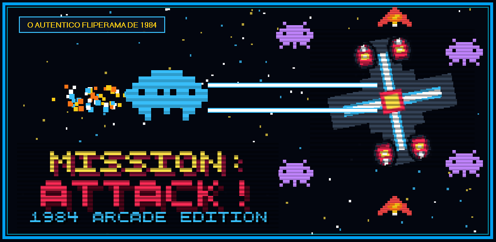
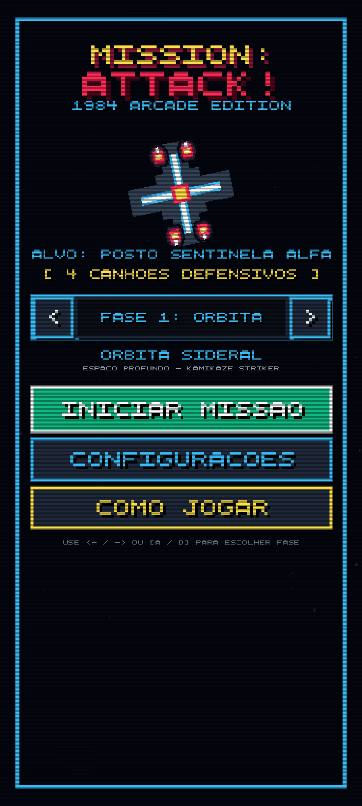
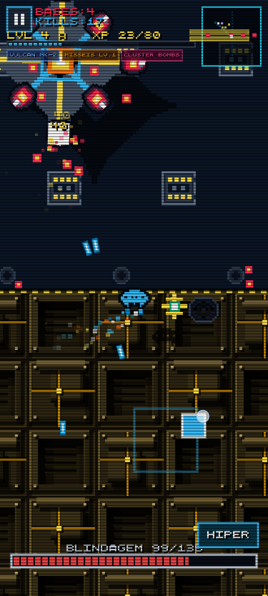
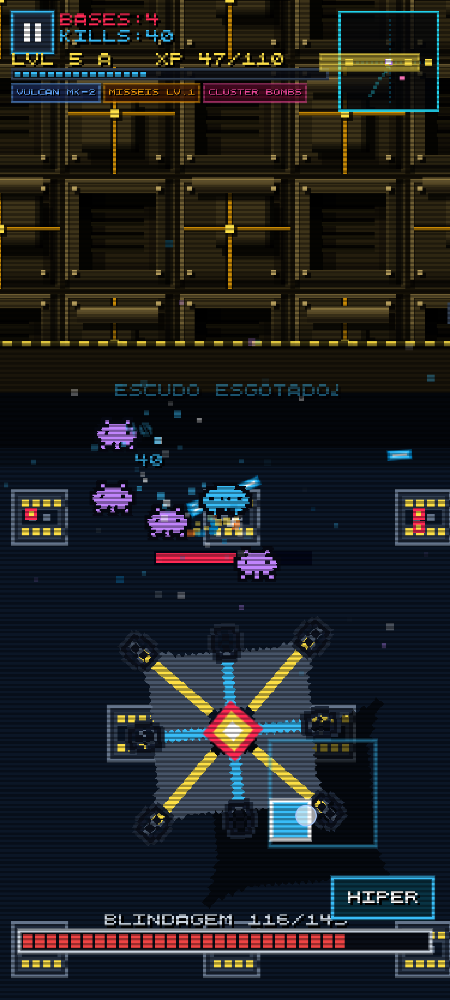
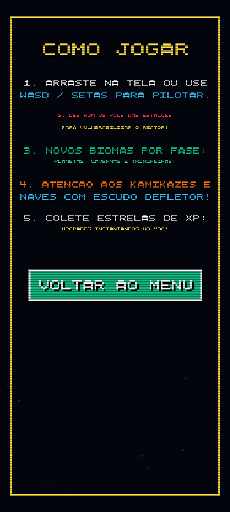
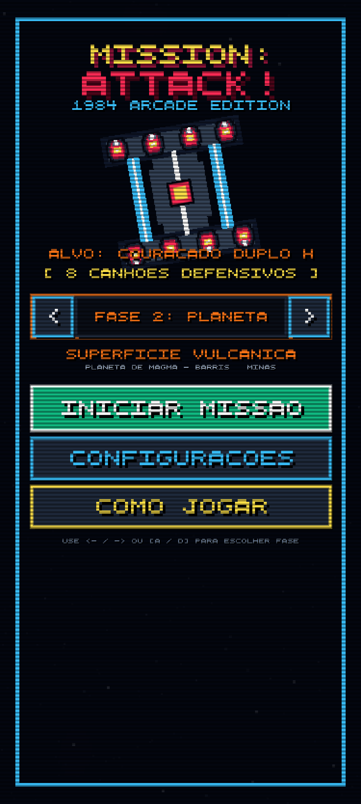
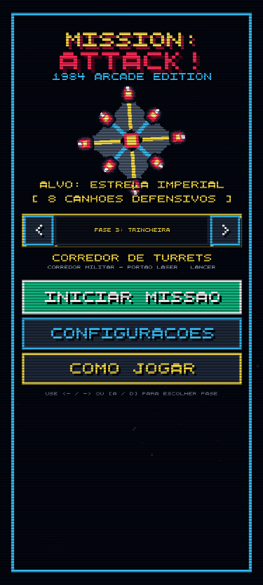

# MISSION: ATTACK! - 1984 ARCADE EDITION 🚀

<div align="center">
  
</div>

<br/>

<div align="center">

[](https://android.com)
[-blue)](https://developer.android.com)
[](https://kotlinlang.org)
[](https://github.com/juleroliveira/mission-attack-arcade)
[](LICENSE)

</div>

---

## 🎮 Sobre o Jogo

**MISSION: ATTACK! 1984 ARCADE EDITION** é uma recriação fiel da era de ouro dos fliperamas dos anos 80. Um shoot 'em up espacial de ritmo frenético com iluminação neon estilizada, estética retrô CRT e resposta tátil imediata para smartphones Android.

### 🌟 Principais Recursos:
- **🎯 Mira Automática Inteligente:** Seus canhões de fótons travam automaticamente nos alvos inimigos mais próximos.
- **🌌 5 Biomas Cósmicos Únicos:**
  1. *Órbita Sideral* (Espaço Profundo com esquadrões Kamikazes)
  2. *Planeta Vulcânico* (Superfície de magma e minas sonoras flutuantes)
  3. *Trincheira Militar* (Corredores de turrets e portões de feixes de laser contínuos)
  4. *Cavernas de Cristal* (Enxames velozes de Swarmers)
  5. *Cidadela Central* (Fortaleza suprema com naves Vanguard de escudo defletor frontal)
- **⚡ Arsenal e Upgrades:** Canhão Vulcan Mk-2, Mísseis teleguiados perseguidores, Cluster Bombs em dispersão, propulsão HIPER e coleta de estrelas de XP com level up em tempo real.
- **🛰️ Radar Tático Orbital:** Display militar no HUD rastreando a posição de esquadrões e bases inimigas.
- **🎵 Trilha Sonora 80s:** Músicas originais dedicadas para abertura (`telainicial.mp3`), combate (`ingame.mp3`) e fim de jogo (`gameover.mp3`).
- **🛡️ 100% Otimizado para Mobile:** Tela cheia imersiva, 60 FPS estáveis, Splash Screen nativa dark neon sem flash branco e zero consumo de dados.

---

## 📸 Capturas de Tela

<div align="center">
  
  &nbsp;
  
  &nbsp;
  
</div>

<div align="center">
  
  &nbsp;
  
  &nbsp;
  
</div>

---

## 🛠️ Tecnologias Utilizadas

- **Kotlin** para Android nativo (Android 14 / `targetSdk 34`)
- **AndroidX Core SplashScreen** para transição suave de inicialização sem tela branca
- **WebView de Alta Performance** acelerada por hardware (60 FPS contínuos)
- **Ponte Nativa JavaScript (`PlayStoreBridge`)** para integração com AdMob e Google Play In-App Billing
- **Web Audio API & HTML5 Audio** para reprodução das músicas MP3 e sintetizador de efeitos sonoros

---

## 🏗️ Como Compilar o Projeto

1. Clone o repositório:
```bash
git clone https://github.com/juleroliveira/mission-attack-arcade.git
cd mission-attack-arcade
```

2. Compile o APK de desenvolvimento:
```bash
./gradlew assembleDebug
```

3. Compile o Android App Bundle (AAB) para a Play Store:
```bash
./gradlew bundleRelease
```

---

## 📄 Política de Privacidade & Loja

Os metadados da Google Play Store e a documentação completa estão localizados na pasta [`docs/playstore/`](docs/playstore/):
- [`STORE_LISTING.md`](docs/playstore/STORE_LISTING.md) — Títulos, descrições para ASO e respostas dos questionários.
- [`privacy_policy.html`](docs/playstore/privacy_policy.html) — Política de privacidade pronta para publicação no GitHub Pages.

---

<div align="center">
  Desenvolvido com ❤️ por <b>Juler Oliveira</b>
</div>
